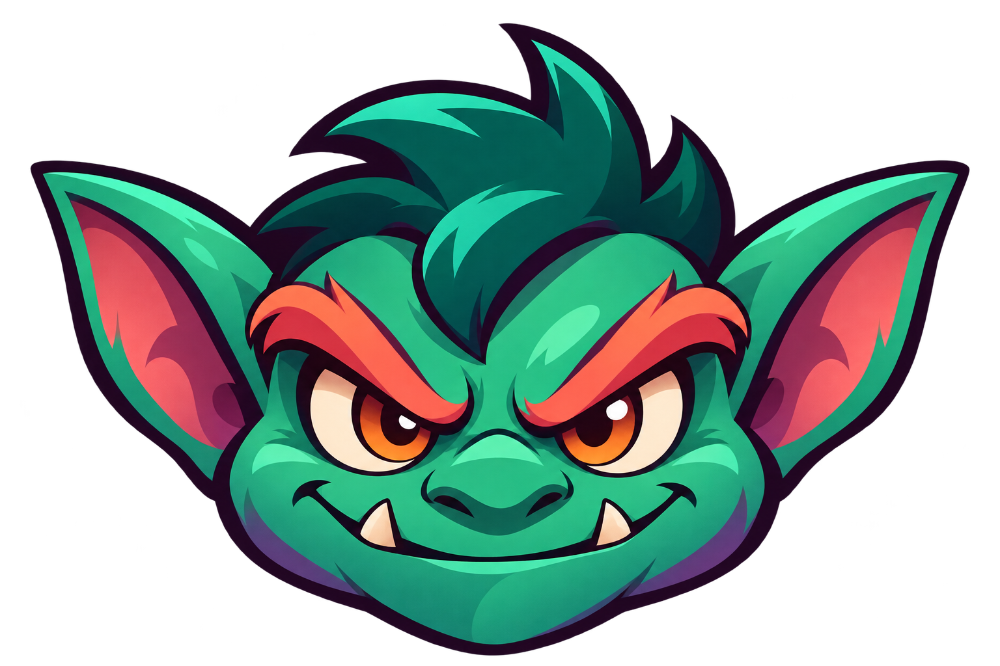
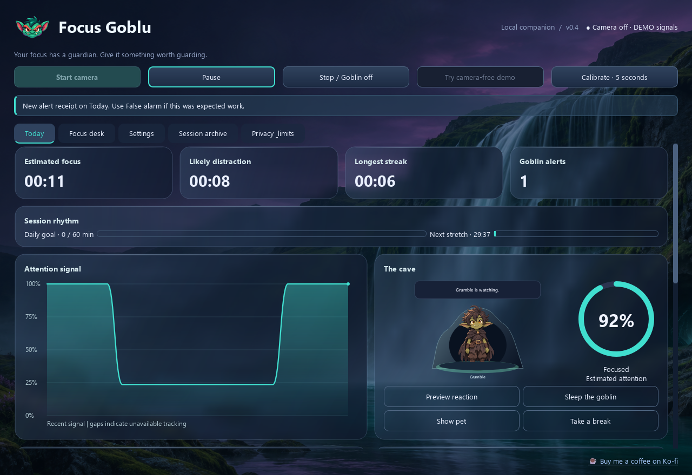

# Focus Goblin 0.3.0



**Project codename: Mistwatch** · Created by **Awais Ali Rafaqat**

Focus Goblin has two editions. The Windows desktop app estimates attention from local webcam input and animates a desktop pet. The Chrome and Edge companion is a browser focus timer with a task field, pause and resume, and a completion notification. The companion runs independently.



| Capability | Windows desktop | Browser companion |
| --- | --- | --- |
| Task and timed sessions | Yes | Yes |
| Local state | SQLite | Browser extension storage |
| Face, gaze and phone estimates | Yes | Desktop edition |
| Desktop pet and effects | Yes | Desktop edition |

## How data moves

```text
Webcam --> Face lighting --> Face landmarks --> Attention rules --> Desktop pet
   |                                                 |
   +--> Local phone detector ------------------------+
                                                     |
Task plan ---------------------------------------> SQLite --> History / export

Browser popup --> Extension worker --> Local storage + alarm --> Notification
```

## Database

| Table | Contents |
| --- | --- |
| settings | One JSON settings record, including calibration and preferences |
| sessions | Start/end, mode, demo marker and computed summary |
| session_plans | Session name, target duration and task checklist |
| events | Timestamped alerts, breaks and false-alarm feedback |
| samples | Elapsed time, confidence and attention state |

The database uses WAL mode and foreign keys. Each event, sample and plan refers to its session. The database stays in the user's local application data directory. Back up the database from the app before moving installations. Browser task text and timer state use a separate local store.

## Browser companion and publishing

Load the `extension` directory unpacked through the browser's extensions page with developer mode enabled. See [Store submission guide](docs/BROWSER-PUBLISHING.md) and [browser privacy policy](docs/BROWSER-PRIVACY.md).

## Project history

The repository preserves the three saved desktop releases as chronological snapshot commits, then records subsequent work by feature. These snapshots capture available release states. See [commit import and verification](docs/HISTORY.md).

A local Windows desktop companion with webcam attention estimates, phone detection, a floating goblin, task sessions and an animated waterfall/glass dashboard.

## Launch

Use the **FocusGoblin-Setup-0.3.0.exe** installer, or extract the complete portable folder and open **FocusGoblin-v0.3.exe**. The installer creates a Start menu shortcut and an uninstaller; startup and desktop shortcuts are optional. Camera stays off until requested.

The source project on this computer is:
`C:\Users\awais\OneDrive\Downloads\Computer vision program\focus-goblin`

For source development, install 64-bit Python 3.11, run setup.ps1, then double-click Launch Focus Goblin.cmd or run:

```powershell
.\.venv\Scripts\python.exe -m focus_goblin
.\.venv\Scripts\python.exe -m focus_goblin --demo
```

## Fixing / testing phone detection

Phone detection is now enabled by default and auto-loads the bundled **YOLOX-S ONNX** model through OpenCV. No PyTorch is needed. A score-decoding defect in the old Eco YOLOv4 adapter has also been corrected.

1. Stop any demo. Choose **Start camera**.
2. Select **Check / calibrate phone**. Hold the entire phone in view for eight seconds. Try front, back, different angles and front lighting.
3. Watch the **phone box**, detector status and class score. A reliable candidate lets Phone Check suggest a sensitivity threshold; otherwise it reports that calibration failed.
4. Settings → Lighting & phone lets you choose Balanced YOLOX, Eco YOLOv4 or Custom. YOLOX uses 640 input; 416/608 applies to Eco only. Custom reads the selected local model path.
5. Save and restart capture after camera/backend/lighting changes. A phone visible while you face the screen does not independently cause an alert.

The source ZIP excludes model binaries. Run download-phone-model.ps1 once if models are missing. Installer/portable deliverables include them. Runtime never downloads models. The bundled ONNX model is ~36 MB, and was downloaded from the official OpenCV Hugging Face model repository.

This remains imperfect: on five phone-labelled COCO128 examples, YOLOX found three matching candidates and missed two. This is a small sanity check, not a benchmark or proof that your phone will be recognized. A phone outside the camera frame cannot be detected.

## Camera, exposure and calibration

Automatic lighting uses face-weighted gamma and local contrast on image pixels. The driver is asked to enable auto exposure when configured; acceptance/unsupported status is shown. Software cannot change the room's lighting, move a lamp, recover clipped detail or guarantee a driver's exposure behavior. Monitor brightness is not changed.

Dense face/iris points can be shown in preview. Face/gaze calibration takes five seconds and needs at least ten usable face samples. Look naturally at the screen with eyes open. Recalibrate after moving camera/seat. Ratios are smoothed, but remain approximate head/iris direction rather than screen-coordinate eye tracking.

Phone detection, calibration/unknown time and absence have separate states. Paper mode allows downward work without a visible phone. Short glances have a grace period; sustained away evidence escalates, with stable recovery and alert cooldowns. Smiles/laughter and thoughts are not inferred.

## Sessions and interaction

- **Focus desk**: name a session, choose duration, type a task and press Enter to add it and start. Add task appends without starting. Task checkboxes persist. Countdown freezes while paused and pauses monitoring at the goal; Resume permits overtime.
- **False alarm** records feedback and silences reactions for 30 seconds while analytics continue. Make rules gentler explicitly increases head/gaze tolerances.
- Global pause/resume defaults to **Ctrl+Alt+P**. Alternatives/conflict reporting are in Settings. It works while other applications have focus on Windows; the app must be running.
- Drag the desktop pet to move it. Tap to provoke a short manual reaction. Eyes follow the cursor when enabled. Right-click for dashboard, pause, break, stop and hide controls. Tray controls are available where supported.
- Name your goblin, change its body color, select personality, motion rate/intensity, custom PCM WAV sound, RGB accent, background/motion/blur and fire placement. Custom skins were intentionally excluded.
- Coach/Chill have gentler behavior and no screen-edge fire. Other personalities have different movement, gestures, captions and generated sounds. Custom sound replaces the generated sound.
- The waterfall is generated scenery with animated mist; it is not a full-motion video. Glass panels blur application-owned background pixels, never the actual desktop.

Pause closes the camera. Stop saves the session, stops sound and clears pet/fire effects. Escape stops monitoring while the dashboard has focus. Break reminders use elapsed monitoring time, not a sitting-posture classifier.

## History and data

Session archive has weekly/monthly/90-day real-session charts and selected-session events. Demo data is labelled and excluded from real daily totals. Export complete JSON, CSV summaries or a SQLite backup. Selected-session deletion asks for confirmation and creates a recovery backup; active sessions are protected. Retention in days is optional (0 keeps all), applies when saved and makes a recovery backup first.

Data lives in **%LOCALAPPDATA%\FocusGoblin\focus.sqlite3**. Local tasks, session names, scores, events, settings and calibration ratios are stored. Camera frames exist only in bounded memory. No raw webcam video, desktop screenshots, microphone recording, cloud inference or telemetry are stored/sent. Imported sounds and recovery backups live in the same local folder. Backups contain private session/task data. SQLite is unencrypted.

Uninstall preserves this data folder. Updates use a stable installer application ID/path. Settings can run a trusted installer you downloaded, with explicit confirmation. There is no online update server, automatic update download or code-signing certificate.

## Checks, performance and build

**19 automated checks passed**, as did compilation and dependency consistency checks. Native Windows checks verified global-shortcut registration/dispatch, session task storage and a nonempty frosted backdrop. The packaged application and installer have additional release checks documented in docs.

The latest spot check negotiated 1280×720 with YOLOX + lighting: ~3.0 observations/sec, ~351 ms per capture/face loop, no face-positive observations in that scene, clean capture release. Real-user gaze/phone accuracy and the 12 FPS camera target remain unverified. Animation is independent (30 FPS target by default), and rendering/inference targets are not guarantees. Try Eco, lower animation FPS or disable background motion/dense dots on a slow laptop.

```powershell
.\.venv\Scripts\python.exe -m pip install -r requirements-dev.txt
.\.venv\Scripts\python.exe -m pytest -q
.\.venv\Scripts\python.exe -m compileall -q focus_goblin
powershell -NoProfile -ExecutionPolicy Bypass -File .\package.ps1
powershell -NoProfile -ExecutionPolicy Bypass -File .\installer.ps1
```

Installer build needs Inno Setup. Python 3.14 is deliberately not used; MediaPipe/NumPy/OpenCV are pinned for Python 3.11.

## Architecture

```text
focus_goblin/
  engine.py       temporal rules and settings
  vision.py       camera / face worker and asynchronous phone worker
  lighting.py     face-weighted image correction
  phone.py        YOLOX + Eco Darknet inference / model discovery
  ui.py           dashboard, preview, calibration, effects orchestration
  workspace.py    sessions, task goals, feedback, preferences, history/data UI
  windows.py      native global shortcut and opt-in startup
  mascot.py       character rendering, cursor/tap interactions
  visuals.py      waterfall scene and frosted native panels
  effects.py      independent click-through screen-edge fire
  storage.py      local SQLite, plans, backups and export
  assets/         logo, scene and generation prompts
tests/            rules, regressions, lighting, storage and UI checks
packaging/        PyInstaller entry and Inno Setup installer definition
```

See **docs/RELEASE-v0.3.md** for desktop feature details and limitations. Prior release notes describe earlier builds.

## Support

If you find Focus Goblin useful, you can support Awais Ali Rafaqat on Ko-fi.

[☕ Buy me a coffee on Ko-fi](https://ko-fi.com/Z3J629YD9V/)

Third-party assets retain their upstream terms. YOLOX is from [OpenCV Zoo](https://github.com/opencv/opencv_zoo/tree/main/models/object_detection_yolox); its Apache 2.0 license is included in models. [OpenCV's Region implementation](https://github.com/opencv/opencv/blob/4.x/modules/dnn/src/layers/region_layer.cpp) documents the weighted Darknet scores. Other dependencies: [MediaPipe](https://github.com/google-ai-edge/mediapipe), [Qt for Python](https://doc.qt.io/qtforpython-6/), [Inno Setup](https://jrsoftware.org/). Optional Ultralytics .pt support is untested in this build and has separate upstream licensing/dependency requirements.
